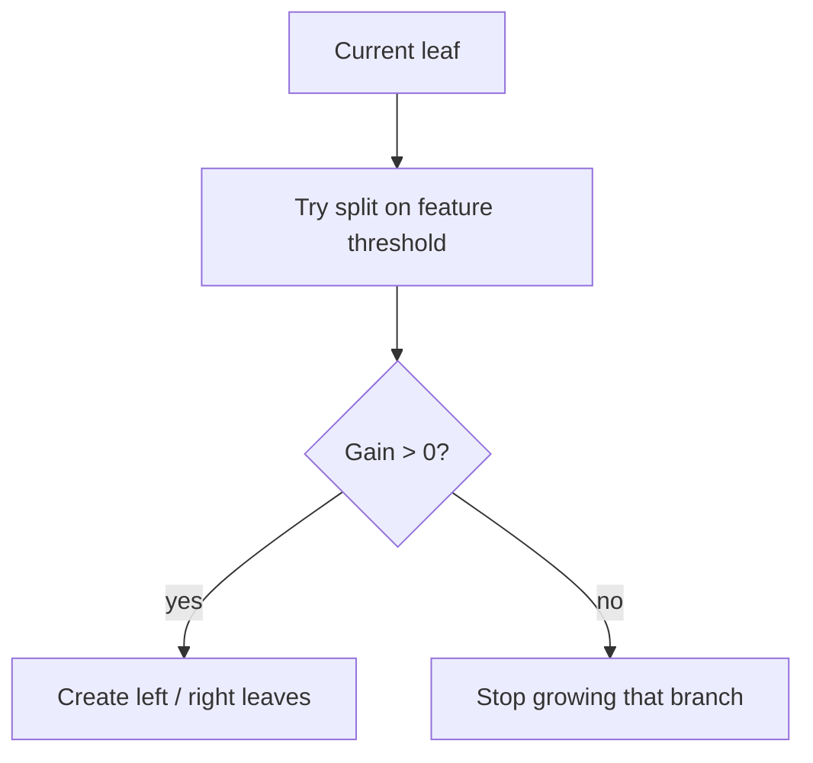

# XGBoost — Simple Guide with Math

Pair with [`src/credit_fraud/modeling.py`](../src/credit_fraud/modeling.py) and Optuna search in [`optimize.py`](../src/credit_fraud/optimize.py).

---

## 1. Big picture

**XGBoost** = *eXtreme Gradient Boosting*: build trees **one after another**, each tree correcting the mistakes of the ensemble so far.


For binary default/fraud we turn the final score into a probability with a sigmoid:

```
                     1
  p̂ᵢ  =  σ( Fₘ(xᵢ) )  =  ───────────────
                          1 + e^(−Fₘ(xᵢ))
```

---

## 2. Additive model

After **m** trees:

```
  Fₘ(x)  =  Fₘ₋₁(x)  +  η · tₘ(x)
```

| Symbol | Meaning |
|--------|---------|
| **tₘ(x)** | Prediction of the new tree |
| **η** | **Learning rate** (`learning_rate`) — step size, typically 0.01–0.2 |
| **Fₘ** | Ensemble score after **m** rounds |

Small **η** ⇒ need more trees (`n_estimators`), but usually **generalises better**.

---

## 3. What each new tree is trying to minimise

XGBoost fits **tₘ** by minimising a **regularised objective**:

```
            n
  L⁽ᵐ⁾  =  Σ   ℓ( yᵢ ,  Fₘ₋₁(xᵢ) + tₘ(xᵢ) )  +  Ω(tₘ)
           i=1
```

### Loss ℓ (binary logistic)

With **pᵢ = σ(F(xᵢ))**:

```
  ℓ(y, F)  =  − [ y · log(p)  +  (1 − y) · log(1 − p) ]
```

Defaults are rare → we also set `scale_pos_weight ≈ (#neg) / (#pos)` so positive errors weigh more.

### Regulariser Ω (keeps trees simple)

```
                    T
  Ω(t)  =  γ T  +  ½ λ  Σ  wⱼ²
                       j=1
```

| Symbol | Code knob | Role |
|--------|-----------|------|
| **T** | (implicit via depth / growth) | Number of leaves |
| **wⱼ** | leaf weights | Prediction value in leaf **j** |
| **γ** | `gamma` | Minimum loss reduction to make a split |
| **λ** | `reg_lambda` | L2 penalty on leaf weights |

---

## 4. Why “gradient” — second-order approximation

Exact optimisation over tree structure is hard. XGBoost approximates the loss around the current prediction with a **Taylor expansion** using gradient **gᵢ** and Hessian **hᵢ**:

```
          ∂ℓ(yᵢ, F)                 ∂²ℓ(yᵢ, F)
  gᵢ  =  ────────── │          hᵢ  =  ─────────── │
            ∂F      │ F=Fₘ₋₁             ∂F²      │ F=Fₘ₋₁
```

For logistic loss:

```
  gᵢ  =  pᵢ − yᵢ ,          hᵢ  =  pᵢ (1 − pᵢ)
```

Intuition:

- **gᵢ**: **how wrong** we are (residual-like)
- **hᵢ**: **how curved** the loss is (confidence / weight of that point)

The leaf weight that minimises the quadratic approx in a leaf **j** with instance set **Iⱼ** is:

```
                − Σᵢ∈Iⱼ  gᵢ
  wⱼ*  =  ─────────────────────
            Σᵢ∈Iⱼ  hᵢ  +  λ
```

And the **gain** from a candidate split (left/right) is:

```
              ⎡   Gₗ²         Gᵣ²        (Gₗ + Gᵣ)²   ⎤
  Gain  =  ½  ⎢ ───────  +  ───────  −  ──────────── ⎥  −  γ
              ⎣ Hₗ + λ      Hᵣ + λ     Hₗ + Hᵣ + λ  ⎦
```

where **G = Σ gᵢ**, **H = Σ hᵢ**.
**Split if Gain > 0** (after paying **γ**).



---

## 5. Hyperparameters we tune with Optuna

| Parameter | Math / role | Typical range in our study |
|-----------|-------------|----------------------------|
| `n_estimators` | Number of trees **M** | 100–400 |
| `max_depth` | Limits tree complexity | 2–8 |
| `learning_rate` **η** | Shrinkage per tree | 0.01–0.2 (log scale) |
| `subsample` | Row bagging fraction | 0.6–1.0 |
| `colsample_bytree` | Feature bagging fraction | 0.5–1.0 |
| `min_child_weight` | Min **Σ hᵢ** in a child | 1–10 |
| `scale_pos_weight` | Upweights minority class | fixed from class ratio |

Objective in the repo: **mean CV PR-AUC** (precision–recall AUC) — better than accuracy when defaults ≈ 22%.

---

## 6. Contrast with Random Forest (session one-liner)

| | Random Forest | XGBoost |
|--|---------------|---------|
| How trees combine | Average many deep trees in **parallel** | Add shallow trees **sequentially** |
| Focus | Variance reduction via bagging | Bias reduction via boosting residuals |
| Key risk | Less sensitive to params | Can overfit if **η** large / **M** huge without regularisation |

---

## 7. Tiny numerical story

Suppose one client has true **y = 1** (will default) and current **p = 0.2**:

```
  g  =  0.2 − 1  =  −0.8 ,
  h  =  0.2 × 0.8  =  0.16
```

A leaf that gathers many such clients gets a **positive** push in **w*** (because **−Σ g > 0**), raising their score next round — that is “learning from mistakes.”

---

## 8. Session walkthrough checklist

1. Draw **Fₘ = Fₘ₋₁ + η · tₘ**.
2. Write logistic loss + sigmoid.
3. Show **gᵢ = pᵢ − yᵢ**, **hᵢ = pᵢ(1 − pᵢ)**.
4. Explain Gain formula as “does this split buy enough loss drop after paying **γ**?”.
5. Open Optuna search space in `optimize_xgboost` and link each knob to the table above.
6. Compare RF vs XGB on the metrics table after training.
